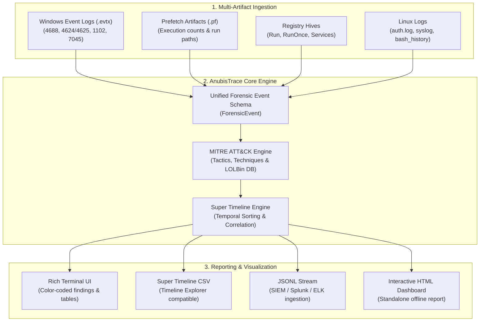

<div align="center">

# ⚖️ AnubisTrace — Forensic Triage & Timeline Correlator

<p align="center">
  <b>Lightweight incident triage and super timeline engine mapped to MITRE ATT&CK.</b><br/>
  <i>Built for digital forensics, incident response (DFIR), and portable USB triage.</i>
</p>

[](https://www.python.org/)
[](https://github.com/Neidielli/AnubisTrace)
[](https://attack.mitre.org/)
[](LICENSE)

</div>

---

## 🧭 Overview

In the chaotic hours of an active security breach, speed and clarity determine whether an incident is contained or becomes catastrophic. Forensic analysts often face gigabytes of fragmented logs, binary prefetch files, and registry keys across multiple hosts.

**AnubisTrace** solves this challenge by acting as an automated digital forensics triager:
* **Ingests Multi-Source Artifacts:** Parses Windows Event Logs (`.evtx`), Prefetch files (`.pf`), Registry keys, and Linux logs.
* **Correlates Chronologically:** Builds a standardized, deduplicated **Super Timeline** down to microsecond precision.
* **Enriches with MITRE ATT&CK:** Automatically tags events with Tactics and Techniques (*Execution, Defense Evasion, Persistence, Credential Access*).
* **Detects LOLBins & Heuristics:** Flags suspicious Living-off-the-Land binaries (e.g. `certutil`, `vssadmin`, encoded PowerShell) and calculates a weighted severity score.
* **USB & Field-Ready:** Engineered to operate completely offline from a pendrive as a standalone executable.

---

## 🏗️ Architecture



---

## ⚡ Quick Start

### 1. Clone & Setup

```bash
# Clone repository
git clone https://github.com/Neidielli/AnubisTrace.git
cd AnubisTrace

# Install dependencies
pip install -r requirements.txt
```

### 2. Run Forensic Triage

```bash
# Scan a folder containing extracted forensic artifacts
python -m anubistrace.cli scan -i /path/to/artifacts --min-severity HIGH

# Run automated live triage from a portable drive (Administrative prompt)
python -m anubistrace.cli live --output D:\ForensicEvidence
```

---

## 🗺️ Project Roadmap

- [x] **Phase 1: Project Scaffolding & Core Schema**
  - [x] Unified Forensic Event Model (`event.py`)
  - [x] MITRE ATT&CK Enrichment Engine (`mitre.py`)
  - [x] Chronological Super Timeline Engine (`timeline.py`)
  - [x] Abstract Parser Interface (`base.py`)
- [x] **Phase 2: High-Performance Artifact Parsers**
  - [x] Windows EVTX Parser (Process creation 4688, Logons 4624/4625, Log clearing 1102, Services 7045)
  - [x] Windows Prefetch (`.pf`) Execution Parser
  - [x] Linux Auth & History Parser (SSH brute force, sudo abuse, bash commands)
  - [x] Realistic forensic artifact samples in `samples/`
- [x] **Phase 3: Threat Detection & Temporal Correlation Engine**
  - [x] Multi-event sliding-window temporal correlation engine (`correlation.py`)
  - [x] Attack chain detection: Brute-Force into success, Anti-forensics / log purging, Ingress download into execution, Ransomware recovery inhibition
  - [x] Declarative Sigma-style YAML detection rules loader (`rules_loader.py`)
  - [x] Pre-packaged attack rules in `rules/`
- [x] **Phase 4: Reporting & Interactive Dashboard**
  - [x] Standalone 100% air-gapped HTML dashboard (`report.html`) with embedded vanilla JS & CSS
  - [x] Interactive Super Timeline table with instantaneous live search and severity filtering
  - [x] MITRE ATT&CK tactics & techniques visual breakdown
  - [x] Dedicated cards for multi-stage correlated attack chains
  - [x] Eric Zimmerman's Timeline Explorer compatible CSV & SIEM-ready JSONL export
- [ ] **Phase 5: Standalone USB Executable (Pendrive Mode)**
  - [ ] Single binary compilation via PyInstaller
  - [ ] Zero-touch live artifact collector script

---

## 📄 License

Distributed under the [MIT](LICENSE) License. See `LICENSE` for more information.

<div align="center">
  <sub>Developed by <a href="https://github.com/Neidielli">Neidielli Rosado</a> • Cybersecurity & Software Engineering</sub>
</div>
